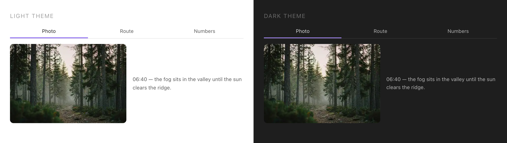
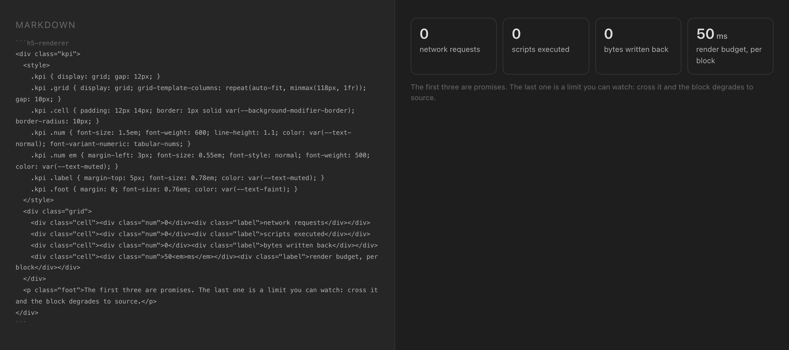
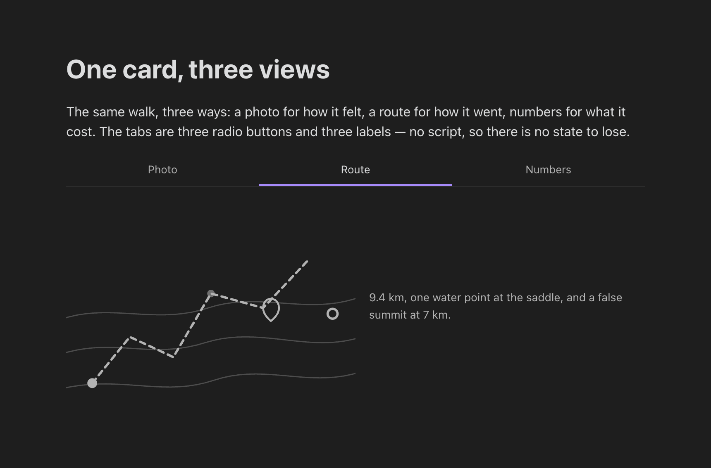
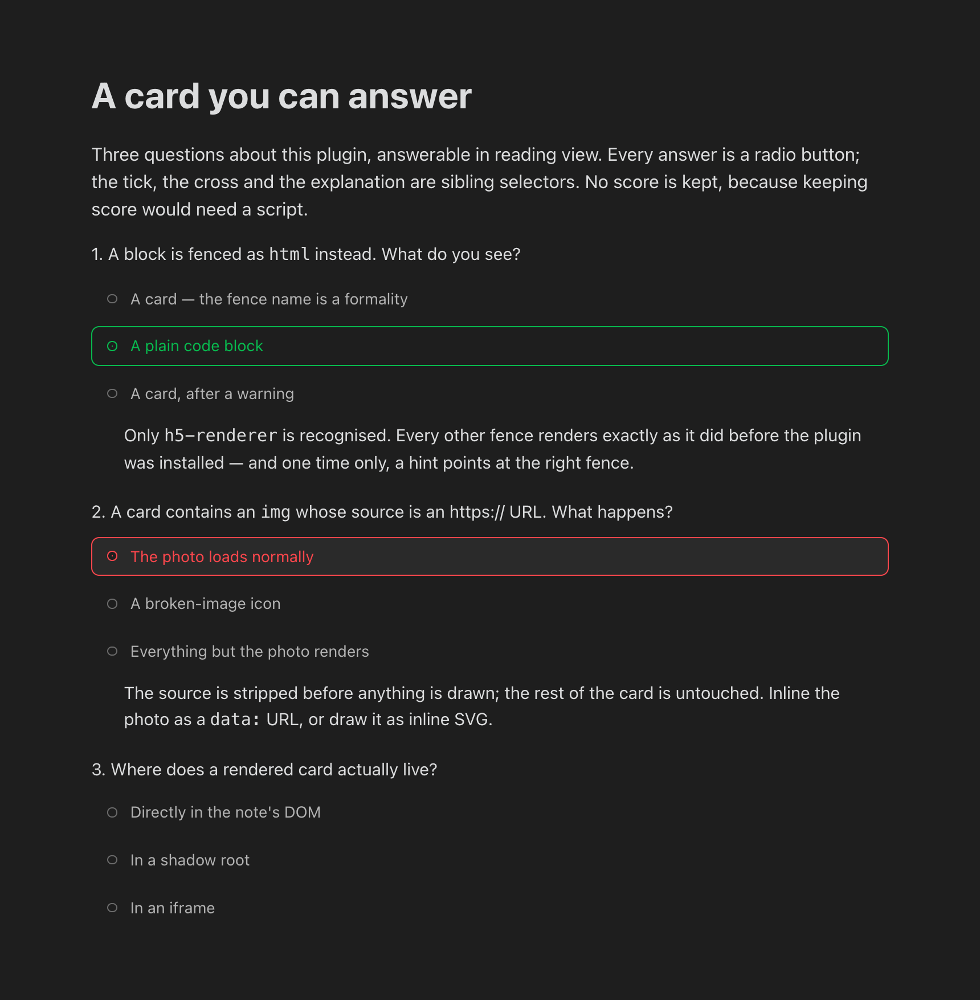
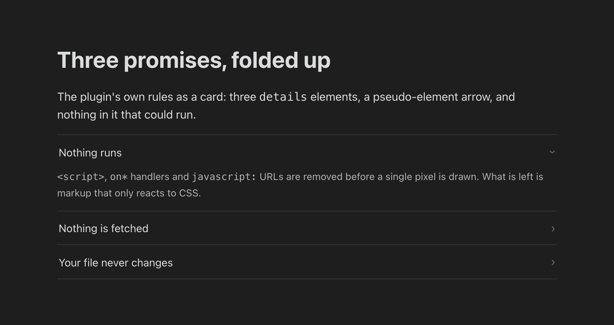
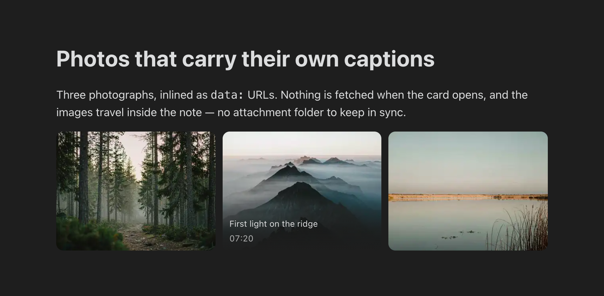
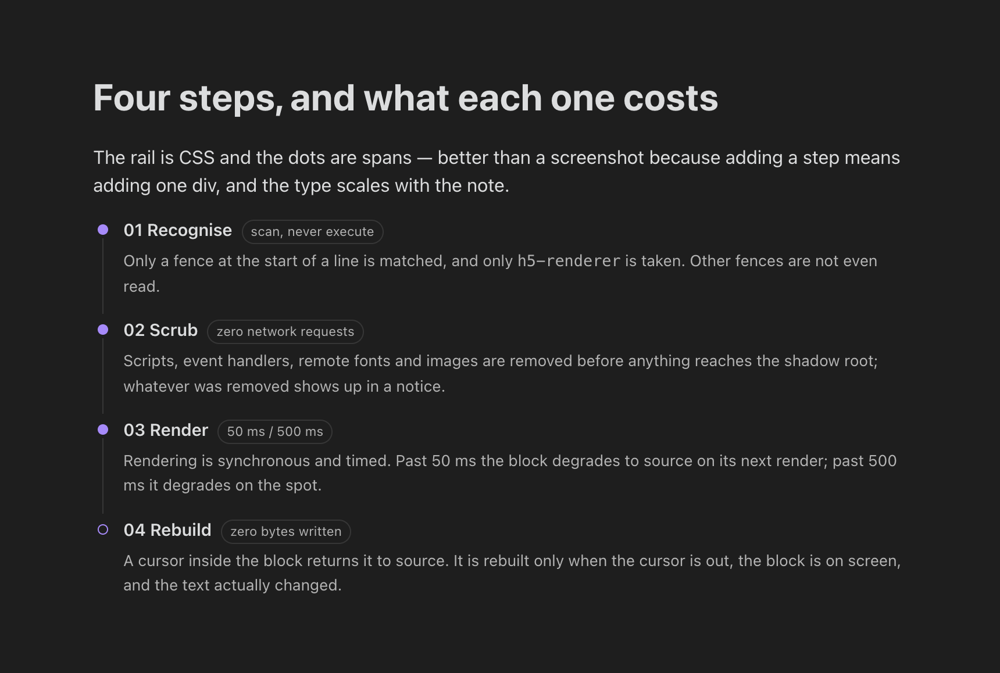
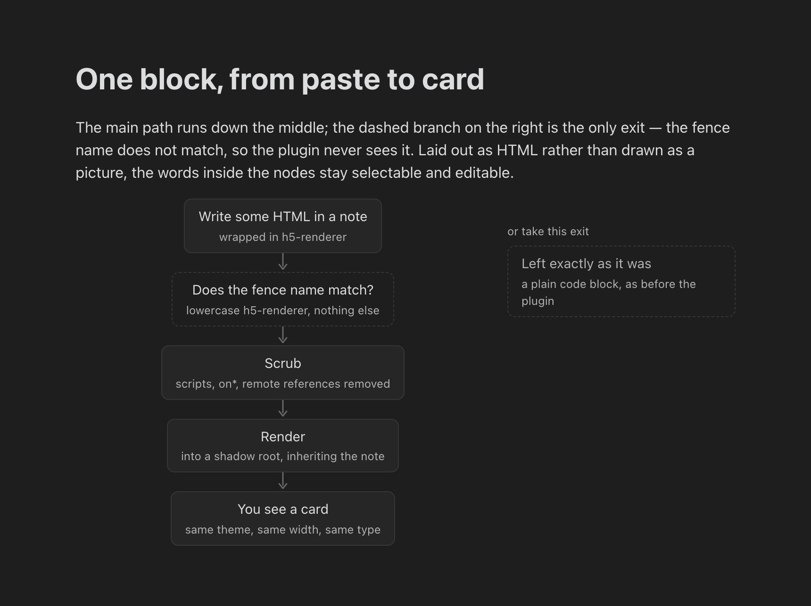
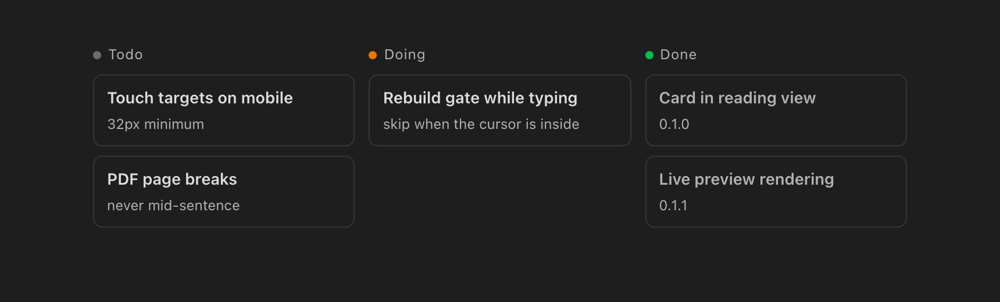
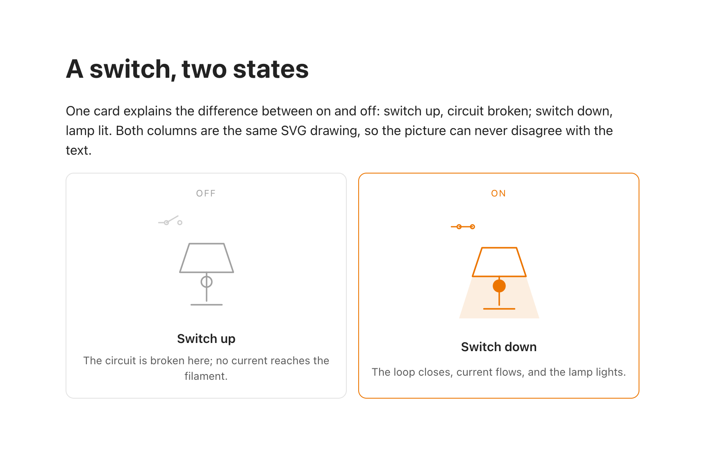

# H5 Card Renderer

Paste an HTML block into an Obsidian note and it becomes **a card that belongs to the
note** — same theme, same column width, same type — while you write, and in reading view.
Built for the blocks an AI hands you.



*One block. No edits between the two halves.*

**30-second tour, narrated:** [watch the mp4](docs/video/h5-card-renderer-en.mp4) ·
Chinese version: [README.zh-CN.md](README.zh-CN.md) ·
[](https://github.com/JChunyu/h5-in-article-renderer/actions/workflows/verify.yml)

## What you get

- **A card where the block was.** In the editor and in reading view. Click the card and
  you land in the source at the line you clicked; click anywhere else and the card returns.
- **Any layout HTML can express.** Side-by-side comparisons, feature matrices, timelines,
  dashboards, a quiz. Mermaid stops at flows; a screenshot cannot follow your theme.
- **Interactive, without a single line of script.** `<details>`, radio tabs, hover
  states, `:has()` — a card reacts because CSS reacts, which is what makes it safe.
- **Nothing runs, nothing is fetched, nothing is written.** The three promises are
  structural, not policies: see [what it never does](#what-it-never-does).

## Cards, not screenshots

Left: what you paste. Right: what the note shows. Both are the same note.



The markup is ordinary HTML with a `<style>` block. Because it is markup and not a
picture, the words stay selectable, the numbers stay `tabular-nums`, and changing a label
is changing a line of text.



Tabs are three radio buttons and three labels. Click one and a different panel becomes
visible — no state object, nothing to re-render, and the choice never reaches your file.

## Interactive cards



This card answers back. Each option is an `<input type="radio">`; the green tick, the red
cross and the explanation that appears are `:checked` sibling selectors — the same CSS a
static card uses. There is no score, because scoring would need a script.

The reason this works at all is deliberate: the editor hands clicks on a card's own
controls (`input`, `label`, `button`, `select`, `textarea`, `summary`, `details`,
`a[href]`) to the control instead of opening the source. So a `<details>` row expands while
you are editing, and the card stays a card.

What works, without scripting:

| Pattern | Built from |
| --- | --- |
| Fold-out sections | `<details>` / `<summary>` |
| Tabs, segmented controls | `<input type="radio">` + `<label for>` + `:checked` |
| Checkboxes that change a layout | `<input type="checkbox">` + `:checked`, `:has()` |
| Hover and focus reveals | `:hover`, `:focus-within`, `:focus-visible` |
| Anything that needs a value | `:has()`, `:not()`, sibling combinators |



## Images that stay in the note



A remote `src` is stripped, so the only way to show a photograph is to inline it. That is
not a limitation to work around — it is what makes "zero network requests" a property you
can watch in devtools, and what lets a note with photographs in it still open on a plane.

```bash
# 4:3, 440px wide, ~7 KB — small enough to live inside the markdown
cwebp -q 55 photo.jpg -o photo.webp
base64 -i photo.webp | tr -d '\n' | pbcopy   # paste after data:image/webp;base64,
```

Inline SVG is often the better answer for diagrams: it is smaller, it scales, and it
inherits `currentColor` so it follows the theme for free.

## More cards, same rules

Four more notes from [`examples/`](examples/), each one container class and theme
variables only. None of them needs a script, an image URL or a fixed pixel width.

<table>
<tr>
<td width="50%" valign="top"><br><sub><b>Timeline.</b> A rail drawn with a border, dots placed by <code>grid</code>.</sub></td>
<td width="50%" valign="top"><br><sub><b>Flowchart.</b> Nodes and arrows in CSS, no diagram library.</sub></td>
</tr>
<tr>
<td valign="top"><br><sub><b>Board.</b> Three <code>minmax(0, 1fr)</code> columns, so a long title wraps.</sub></td>
<td valign="top"><br><sub><b>Switch.</b> Two panels and one <code>:checked</code> rule.</sub></td>
</tr>
</table>

## Use

1. Command palette → **Insert sample note**. You get a note with three cards; click one to
   see it open as source, click away to get it back.
2. Command palette → **Copy AI instructions**, paste it into any model, then add your
   request.
3. Paste what it returns into a note. The card appears where you were typing.
4. In reading view, hover a card and click the top-right toggle to keep that one block as
   source for as long as you like. Neither view state is ever written to disk.

[`examples/`](examples/) holds eight notes you can copy outright — [tabbed
views](examples/tabs.md), [a hover
gallery](examples/gallery.md), [a quiz](examples/quiz.md), [three
promises](examples/promises.md), [a switch](examples/lamp-switch.md), [numbers and a
board](examples/kpi-board.md), [a timeline](examples/timeline.md) and [a
flowchart](examples/flowchart.md). Chinese copies live in [`examples/zh/`](examples/zh/).
Each note uses one top-level container class and theme variables only, so it fits any
theme.

## Install

- **BRAT**: add this repository as a beta plugin, enable it, then enable *H5 Card Renderer*
  under Community plugins.
- **Manual**: create `<vault>/.obsidian/plugins/html-card-renderer/`, copy `main.js`,
  `manifest.json` and `styles.css` into it, reload Obsidian, enable the plugin.

Requires Obsidian `1.12.7` or newer. The manifest marks the plugin desktop-only until it
has been tested on mobile; nothing in the design precludes it, so that flag is expected to
flip back.

## The fence

One fence name is recognised, and only one:

````markdown
```h5-renderer
<div class="card">
  <style>
    .card { display: grid; gap: 12px; color: var(--text-normal); }
  </style>
  <h3>Title</h3>
  <p>Body</p>
</div>
```
````

`html`, `h5` and `H5-Renderer` are not recognised, and neither is a fence inside a
blockquote or indented four spaces. An unrecognised fence renders exactly as it did before
the plugin was installed — same code, same attributes, not one extra console warning. The
first time you open a note containing a plain ```` ```html ```` block, a one-time inline
hint points at the right fence; it never appears again.

## Editing, and reading

A card is view state. Your cursor inside the block turns it back into source, so nothing
is ever rebuilt under your cursor; move out and the card returns. The file is byte-identical
before and after, and the undo history never sees the swap. Cards appear in print and in
exported PDF too.

Two preferences decide what a fresh block looks like: *Rendered* or *Source*. Four settings
in total — enable rendering, default state, show the toggle button, show error hints — and
all four apply to notes that are already open, without a reload.

## What it never does

1. **It does not execute scripts.** `<script>`, `on*` handlers and `javascript:` URLs are
   removed before anything is displayed.
2. **It never goes online.** `<link>`, `@import`, remote fonts, CDN scripts,
   `<iframe>`/`<object>`/`<embed>`, non-`data:` CSS `url()` and every resource attribute
   that would fetch something (`src`, `srcset`, `poster`, `xlink:href`) are stripped. A
   block renders with zero network requests. Plain hyperlinks (`<a href="https://…">`)
   stay: they only act when you click them.
3. **It never writes back to your notes.** Your Markdown file is byte-identical before and
   after; only what you see changes. Opening a card, keeping one as source, scrolling a
   screen of them — none of it touches the file or your undo history. (The *Insert sample
   note* command creates a new note when you ask for it, and your four preferences live in
   the plugin's own `data.json`; neither touches the note you are reading.)
4. **It recognises exactly one fence.** Everything else renders exactly as it did before
   you installed the plugin.

## Performance and degradation

Rendering is synchronous, and each block is measured against two fixed budgets: over
**50 ms** the block still finishes that render but degrades to its source on the next one;
over **500 ms** it degrades immediately. A degraded block shows its source plus a notice;
clicking **Preview** re-renders it once, bypassing the budget. The two constants are not
configurable, and there is no loading state by design.

The same budgets apply in the editor, with one addition that keeps typing smooth: a block
is only rebuilt when your cursor is outside it, it is at least partly on screen, and its
text actually changed. Blocks you scroll past release their output and rebuild when you
come back.

## Data and privacy

No telemetry, no analytics, no network access. The plugin stores exactly two kinds of data,
both inside your vault:

- `.obsidian/plugins/html-card-renderer/data.json` — your four settings plus three local
  flags (onboarding seen, sample note offered, sample note declined).
- Nothing else. Block state (card / source / kept as source) lives only in memory for the
  lifetime of the open view, and the editor and reading view keep separate state — opening
  a card in one never changes the other.

Removing the plugin directory deletes all of it.

## The AI constraint card

The card below is generated from `src/constraint-card.md` by `scripts/sync-docs.mjs`.
Do not edit it here — `scripts/verify-docs.mjs` fails the release if the copies drift.
The card is written in Chinese on purpose: it is an instruction to a model, and one
canonical wording is easier to keep consistent than two. If you want to read it before
sending it, rules 1 through 8 are short and self-contained.

<!-- constraint-card:start -->
````text
当你要为 Obsidian 笔记生成一段"可视展示块"时，请遵守以下约定：

1. 用代码块的 fence 名 h5-renderer，不要用 html：
   ```h5-renderer
   <div>...</div>
   ```

2. 只写静态内容：div / span / table / svg / style。
   需要"能点"的效果时，只用 CSS 原生控件：details + summary、
   input[type=checkbox|radio] + label、:hover / :focus-within / :focus-visible / :checked。
   不要写 <script>、不要写 on* 事件属性、不要写 javascript: 链接。

3. 不引用任何外部资源：不写 <link>、@import、远程字体、CDN 脚本、外部图片 URL。
   图形优先用内联 <svg>；要用照片就内联成 data: URL（base64），
   不要写 https:// 开头的 src。

4. 样式集中在一个 <style> 里，选择器收敛：
   不要把规则写到 body / html / * / :root 上；
   所有规则用一个统一的顶层容器类包裹（例如 .card），避免与其他块冲突。

5. 不写死尺寸：宽度用 100% 或 max-width，不要用 1200px 之类固定像素；
   高度同理，避免超出笔记栏或产生滚动条。

6. 颜色优先使用 Obsidian 的 CSS 变量，以便自动跟随浅色/深色主题：
   var(--text-normal)、var(--text-muted)、var(--background-primary)、
   var(--background-secondary)、var(--text-accent)、var(--background-modifier-border)。
   最外层容器不要设置不透明背景，保持透明以融入笔记。

7. 简单优先：优先用 flex / grid 做稳健布局，不追求炫技；
   单块代码尽量控制在 150 行以内。

8. 只输出这一个代码块，不要额外解释。
````
<!-- constraint-card:end -->

## Accessibility

Toggles are reachable with `Tab` and fire on `Enter`/`Space`, carry a localized
`aria-label`, and use the theme's own focus ring — the editor's toggle is the same control,
reached the same way. Notices are `role="status"` with `aria-live="polite"` (`assertive`
only when a block fails), are focusable so `Escape` can close them, and never steal focus.
There are no positive `tabindex` values, no focus traps and no custom keyboard shortcuts, and
opening or closing a card never moves focus.

Interactive cards keep their own keyboard behaviour: a radio group is still a radio group,
a `<summary>` still opens on `Enter`. The interface ships in Chinese and English only; other
interface languages fall back to English. Rendered cards live in a shadow root, so how a
screen reader traverses their content depends on the browser and the theme.

The accessibility of the *card's own content* is determined by the HTML an AI wrote. The
plugin does not repair it, and cannot promise it.

## Troubleshooting

- **My block shows as a plain code block.** The fence must be exactly `h5-renderer`,
  lowercase, with the hyphen, at the start of a line, indented less than four spaces, and
  not inside a blockquote or callout. Both fences must be present.
- **My block turns back into source while I type in it.** Expected: a card opens into
  source whenever your cursor is inside the block. Move the cursor out.
- **A block inside a callout or an indented list stays a code block while editing.** Those
  positions fall back to plain code blocks when the editor cannot render them reliably; the
  same block still renders in reading view.
- **A card suddenly shows its source with a notice.** It exceeded the render budget; click
  *Preview* to render it once more, or split the card.
- **Images inside a card are missing.** Remote images are stripped. Inline them as `data:`
  URLs or use inline `<svg>`.
- **A control inside a card does nothing while editing.** Only `input`, `label`, `button`,
  `select`, `textarea`, `summary`, `details` and `a[href]` own their clicks; anything else
  opens the source. In reading view the whole card is live.
- **A notice says scripts were removed.** The block contained `<script>`, `on*` handlers or
  remote references; the rest of the card still renders.
- **I want the plugin to disappear.** Turn off *Enable rendering*: every block returns to a
  plain code block with no toggle, no notice and no host element left behind.

## Development

```bash
npm ci
npm run lint       # the community review's own rule set (eslint-plugin-obsidianmd)
npm run typecheck
npm test
npm run build      # writes main.js
```

`npm run lint` is the one that matters before a release: it runs the `obsidianmd/*` rules
plus the DOM-safety and type-aware rules the community-plugin review applies, so a clean
run means the source cannot fail review on those grounds.

The images and examples in `docs/` are generated, never hand-edited:

```bash
npm run examples   # examples/*.md and examples/zh/*.md, from tools/demos.mjs
npm run shots      # docs/screenshots/*.png, through the real scrub + render stages
npm run video      # docs/video/*.mp4, from the same cards
npm run voice      # narration for them, from tools/video/copy.mjs
```

## Versioning

Versions follow semantic versioning. `manifest.json` is the single source of truth;
`versions.json` maps each release to the `minAppVersion` it was built against, and
`npm run verify-docs` fails unless `manifest.version`, `package.json.version` and the
`versions.json` entry agree (the git tag is checked by the release itself).

Breaking changes are limited to two kinds, and each ships with migration steps in the
generated release notes: renaming the recognized fence, and changing or removing a setting.
Nothing else in the public surface is intended to break within a major version.

## Verify a release

Every release is built and published by `.github/workflows/release.yml`, which attests the
three assets it ships, so you never have to take the tag on faith:

```bash
gh release download <version> --repo JChunyu/h5-in-article-renderer
gh attestation verify main.js --repo JChunyu/h5-in-article-renderer
gh attestation verify manifest.json --repo JChunyu/h5-in-article-renderer
gh attestation verify styles.css --repo JChunyu/h5-in-article-renderer
```

The workflow runs the same verification against what it just published: a missing or
mismatched attestation fails the run and flags the release as unverified. The assets are
already public by then, so check the run status before installing.

## Before publishing a fork

`manifest.json` carries publisher identity that only a maintainer can supply. Replace
`author`, `authorUrl` and `id` (after checking the id is unique in the community directory)
before you ship your own build.

## License

MIT — see [LICENSE](LICENSE).
