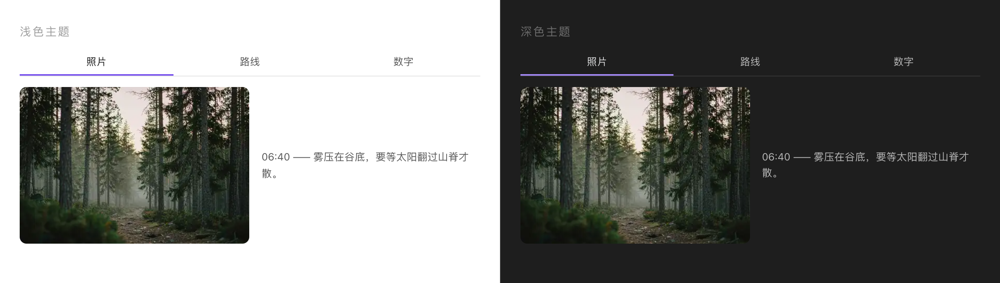
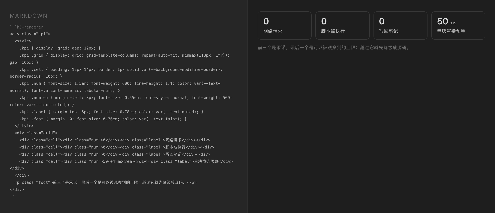
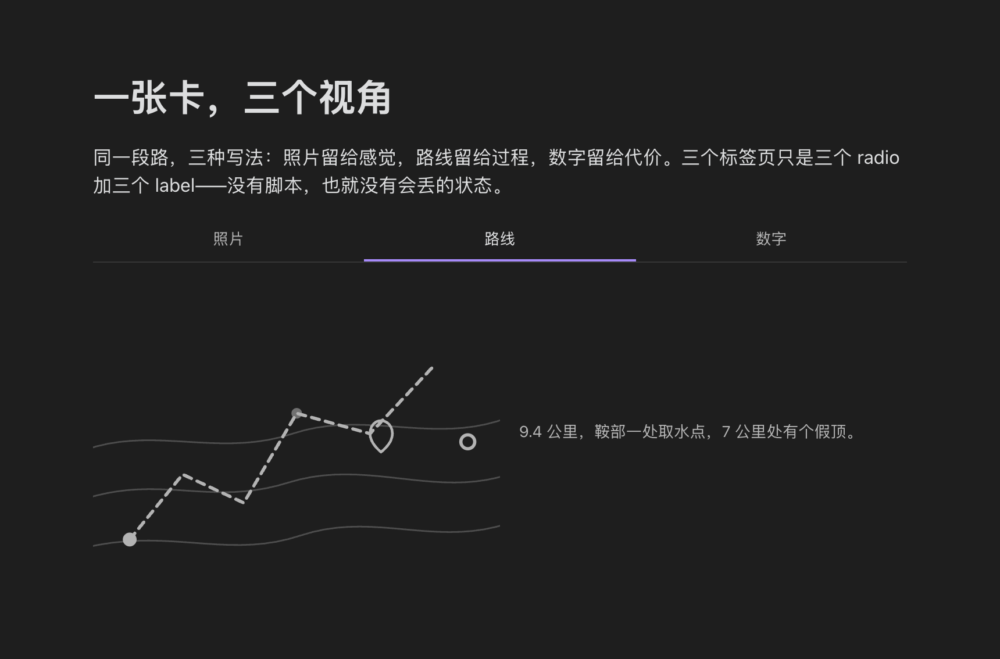
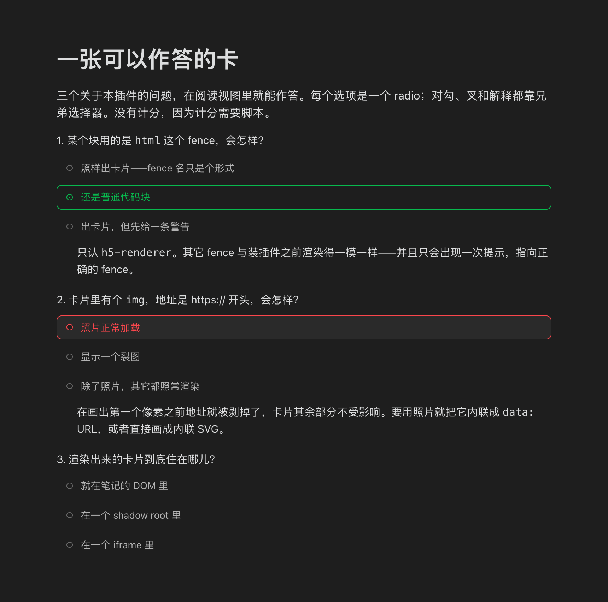
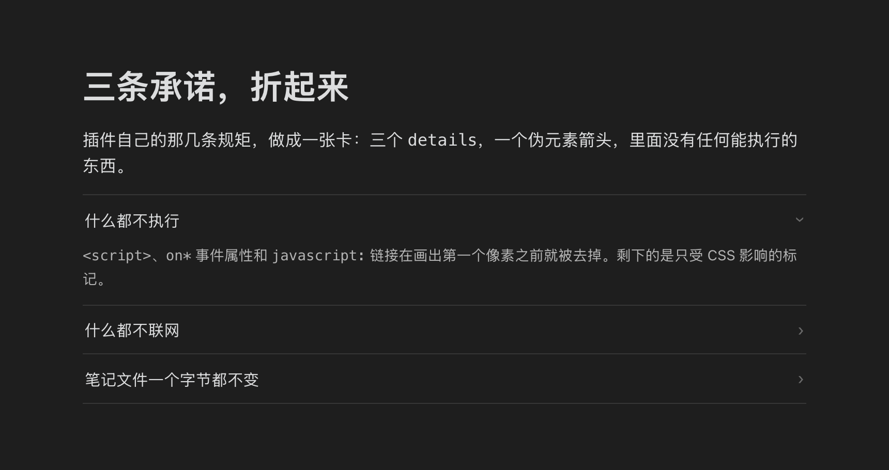
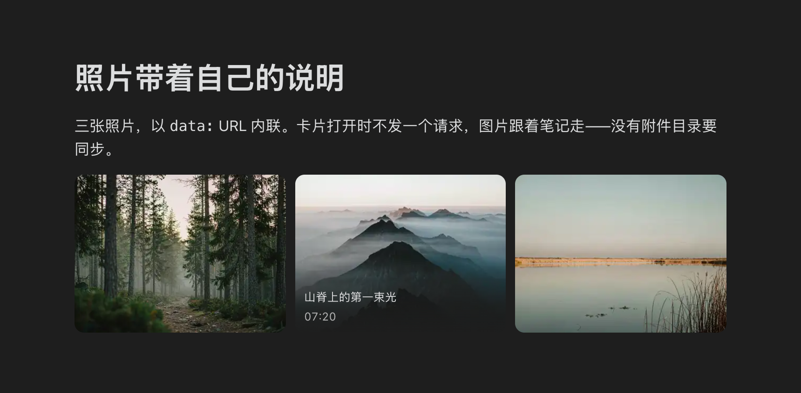
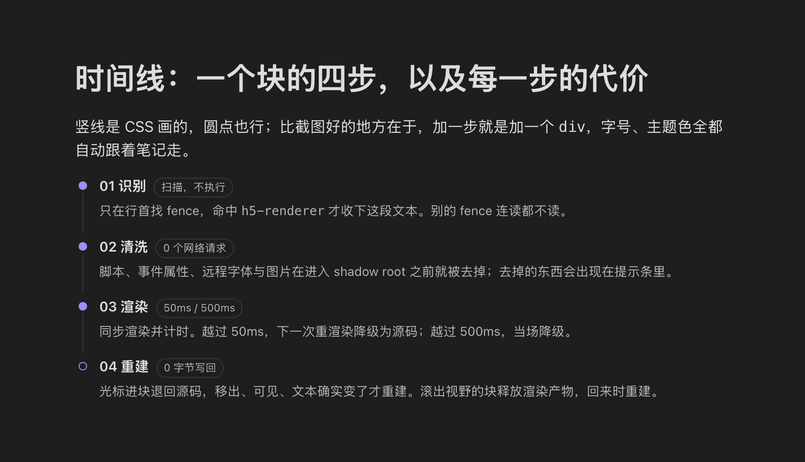
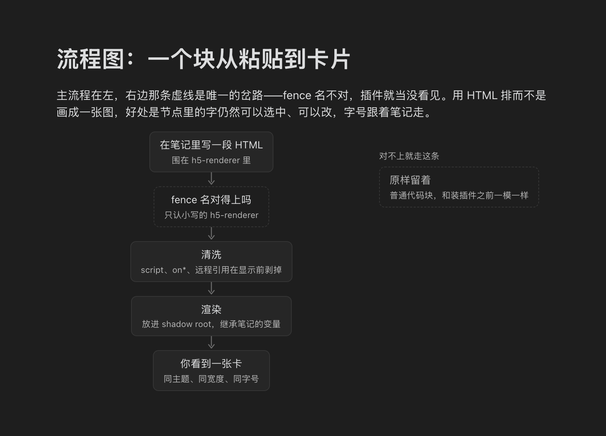
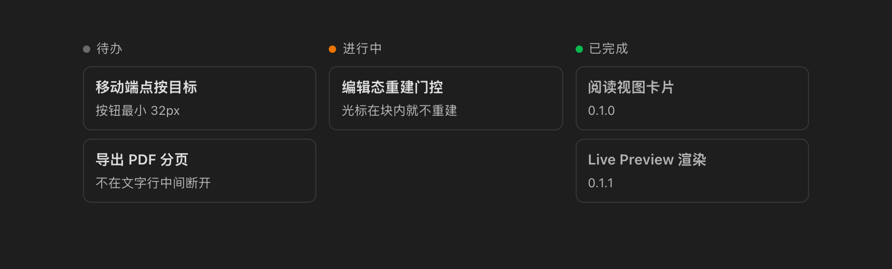
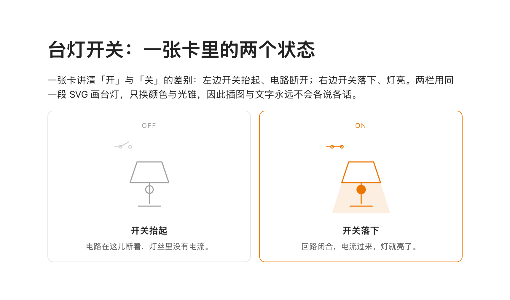

# H5 Card Renderer

把一段 HTML 粘进 Obsidian 笔记，它就变成**一张属于这篇笔记的卡**——同主题、同栏宽、同字号：写的时候是，阅读视图里也是。为 AI 递给你的那些块准备。



*同一个块。左右两半之间，一个字都没改。*

**30 秒速览：** [看这段视频](docs/video/h5-card-renderer-zh.mp4) ·
English version: [README.md](README.md) ·
[](https://github.com/JChunyu/h5-in-article-renderer/actions/workflows/verify.yml)

## 它给你什么

- **卡片就长在块原来的位置。** 编辑态和阅读视图都是。点卡片，就落到你点的那个位置的源码；
  点到别处，卡片回来。
- **HTML 能排的版式它都能排。** 左右对比、特性矩阵、时间线、仪表盘、一张小测卷。Mermaid
  到流程图就为止了；截图没法跟着你的主题换色。
- **能交互，且一行脚本都没有。** `<details>`、radio 标签页、hover 状态、`:has()`——
  卡片会动，是因为 CSS 会动，这正是它安全的原因。
- **不执行、不联网、不写回。** 这三条是结构决定的结果，不是口头承诺，见
  [它绝不做什么](#它绝不做什么)。

## 是卡片，不是截图

左边是你粘进去的东西，右边是笔记显示的东西。同一篇笔记。



这些标记就是普通 HTML 加一个 `<style>`。正因为它是标记而不是一张图片，里面的字仍然可以选中，
数字仍然用 `tabular-nums`，改一个标签就是改一行文本。



标签页就是三个 radio 加三个 label。点一个，另一块内容出现——没有状态对象、没有需要重渲染的界面，
这个选择也永远不会写进你的文件。

## 会回应的卡片



这张卡会回应你。每个选项是一个 `<input type="radio">`；出现的对勾、叉和那段解释，全是
`:checked` 的兄弟选择器——和静态卡片用的是同一套 CSS。没有计分，因为计分需要脚本。

这件事能成立是刻意设计的：编辑态下，点在卡片自有控件（`input`、`label`、`button`、`select`、
`textarea`、`summary`、`details`、`a[href]`）上的那一下，会被交给控件本身，而不是去展开源码。
所以你在编辑时展开一条 `<details>`，卡片仍然是卡片。

不写脚本也能做到的：

| 效果 | 用什么搭 |
| --- | --- |
| 折叠面板 | `<details>` / `<summary>` |
| 标签页、分段控件 | `<input type="radio">` + `<label for>` + `:checked` |
| 勾选后改变布局 | `<input type="checkbox">` + `:checked`、`:has()` |
| 悬停 / 聚焦显形 | `:hover`、`:focus-within`、`:focus-visible` |
| 需要读到「值」的样式 | `:has()`、`:not()`、兄弟组合器 |



## 图片留在笔记里



远程 `src` 会被剥掉，所以想放照片只有内联这一条路。这不是需要绕开的限制——正是它让
「零网络请求」成为你在 devtools 里当场能看见的事实，也让一篇带照片的笔记照样能在飞机上打开。

```bash
# 4:3、440px 宽、约 7 KB——小到可以直接住在 markdown 里
cwebp -q 55 photo.jpg -o photo.webp
base64 -i photo.webp | tr -d '\n' | pbcopy   # 粘在 data:image/webp;base64, 后面
```

画示意图往往内联 SVG 更划算：更小、可缩放，而且继承 `currentColor`，自带跟随主题的能力。

## 更多版式，同一套规矩

下面四篇也在 [`examples/`](examples/) 里，同样只有一个容器类、只用主题变量：不需要脚本，不引用任何
图片地址，也不写死像素宽度。

<table>
<tr>
<td width="50%" valign="top"><br><sub><b>时间线。</b> 竖线是一条 border，圆点由 <code>grid</code> 定位。</sub></td>
<td width="50%" valign="top"><br><sub><b>流程图。</b> 节点和箭头都是 CSS，不引任何绘图库。</sub></td>
</tr>
<tr>
<td valign="top"><br><sub><b>看板。</b> 三列 <code>minmax(0, 1fr)</code>，长标题只会换行。</sub></td>
<td valign="top"><br><sub><b>开关。</b> 两块面板，一条 <code>:checked</code> 规则。</sub></td>
</tr>
</table>

## 使用

1. 命令面板 → **插入示例笔记**。得到一篇带三张卡片的笔记：点卡片会展开成源码，点到别处回来。
2. 命令面板 → **复制给 AI 的要求**，粘给任何模型，再补上你的需求。
3. 把它返回的内容粘进笔记，卡片就出现在你刚才打字的地方。
4. 阅读视图里把鼠标移到卡片上，点右上角切换按钮，可以让这一块一直保持源码，直到你再点一次。
   两种视图状态都不会写到磁盘上。

[`examples/`](examples/) 里有八篇可以直接抄的笔记：[标签页](examples/tabs.md)、
[悬停图集](examples/gallery.md)、[小测卷](examples/quiz.md)、[三条承诺](examples/promises.md)、
[台灯开关](examples/lamp-switch.md)、[指标与看板](examples/kpi-board.md)、
[时间线](examples/timeline.md)、[流程图](examples/flowchart.md)。中文版在
[`examples/zh/`](examples/zh/)。每篇只有一个顶层容器类、只用主题变量，任何主题下都不会失配。

## 安装

- **BRAT**：把本仓库加为 beta 插件，启用，然后在社区插件里打开 *H5 Card Renderer*。
- **手动**：新建 `<vault>/.obsidian/plugins/html-card-renderer/`，把 `main.js`、`manifest.json`、
  `styles.css` 放进去，重载 Obsidian 后启用。

需要 Obsidian `1.12.7` 或更新版本。在移动端实测通过之前，manifest 把本插件标记为仅桌面端；
这里没有任何设计会让它必然不可用，该标记预期会改回去。

## 只认一个 fence

只认一个，且只有一个：

````markdown
```h5-renderer
<div class="card">
  <style>
    .card { display: grid; gap: 12px; color: var(--text-normal); }
  </style>
  <h3>标题</h3>
  <p>正文</p>
</div>
```
````

`html`、`h5`、`H5-Renderer` 都不认；写在引用块里、或者缩进四个空格的也不算。不被认出来的 fence
与装插件之前渲染得一模一样——同样的代码、同样的属性，控制台不会多一句警告。第一次打开含普通
```` ```html ```` 块的笔记时，笔记顶部会出现一次内联提示，指向正确的 fence；此后不再出现。

## 编辑态与阅读视图

卡片是视图状态。光标进到块里，它退回源码，所以永远不会在你的光标底下重建；移出去，卡片回来。
文件在处理前后逐字节一致，撤销栈也从未看见这次替换。打印与导出的 PDF 里同样是卡片。

新块默认长什么样由一项偏好决定：*渲染结果* 还是 *源码*。设置页总共四项——启用渲染、
新块默认状态、显示切换按钮、显示错误提示——四项都立即作用于已经打开的笔记，不需要重载。

## 它绝不做什么

1. **不执行脚本。** `<script>`、`on*` 事件属性和 `javascript:` 链接在显示之前就被剥离。
2. **绝不联网。** `<link>`、`@import`、远程字体、CDN 脚本、`<iframe>`/`<object>`/`<embed>`、
   非 `data:` 的 CSS `url()`，以及一切会触发请求的资源属性（`src`、`srcset`、`poster`、
   `xlink:href`）都会被剥离，所以渲染全过程零网络请求。普通超链接（`<a href="https://…">`）
   会保留——它只在你点击时才动作。
3. **不写回你的笔记。** Markdown 文件在处理前后逐字节一致，变的只有你看到的样子。展开卡片、
   让某个块保持源码、滚过一屏卡片——都不碰文件，也不动撤销栈。（*插入示例笔记* 命令只在你主动
   执行时新建一篇笔记，四项偏好存在插件自己的 `data.json` 里，两者都不碰你正在读的这篇笔记。）
4. **只认一个 fence。** 其它所有内容与你装插件之前渲染得完全一样。

## 性能与降级

渲染是同步的，每个块对着两条固定预算计时：越过 **50ms**，这次仍然渲染完，但下一次会降级成源码；
越过 **500ms**，当场降级。降级的块显示源码加一条提示，点 **预览** 可以再渲染一次，这次不受预算
限制。两个常数不可配置，也没有加载态——这是刻意的。

同样的预算也作用于编辑态，另加一条让打字不卡顿的条件：只有光标在块外、块至少有一部分在屏幕上、
且文本确实变了，才会重建。滚出视野的块会释放渲染产物，回来时重建。

## 数据与隐私

没有遥测、没有统计、不联网。插件只存两类数据，都在你的 vault 里：

- `.obsidian/plugins/html-card-renderer/data.json` —— 四项设置加三个本地标记（引导已看过、
  示例笔记已询问过、示例笔记已拒绝）。
- 没有别的了。块状态（卡片 / 源码 / 保持源码）只存在于当前打开视图的内存里，编辑态与阅读视图
  各自独立——在一边展开卡片，永远不会改变另一边。

删掉插件目录，这些数据就都没了。

## 给 AI 的约束卡

下面这段由 `scripts/sync-docs.mjs` 从 `src/constraint-card.md` 生成。不要在这里改——
两处一旦不同，`scripts/verify-docs.mjs` 会让发布失败。这段刻意用中文写：它是给模型的指令，
一份权威措辞比两份更容易保持一致。发送前想先读一遍的话，第 1 到第 8 条都很短。

<!-- constraint-card:start -->
````text
当你要为 Obsidian 笔记生成一段"可视展示块"时，请遵守以下约定：

1. 用代码块的 fence 名 h5-renderer，不要用 html：
   ```h5-renderer
   <div>...</div>
   ```

2. 只写静态内容：div / span / table / svg / style。
   需要"能点"的效果时，只用 CSS 原生控件：details + summary、
   input[type=checkbox|radio] + label、:hover / :focus-within / :focus-visible / :checked。
   不要写 <script>、不要写 on* 事件属性、不要写 javascript: 链接。

3. 不引用任何外部资源：不写 <link>、@import、远程字体、CDN 脚本、外部图片 URL。
   图形优先用内联 <svg>；要用照片就内联成 data: URL（base64），
   不要写 https:// 开头的 src。

4. 样式集中在一个 <style> 里，选择器收敛：
   不要把规则写到 body / html / * / :root 上；
   所有规则用一个统一的顶层容器类包裹（例如 .card），避免与其他块冲突。

5. 不写死尺寸：宽度用 100% 或 max-width，不要用 1200px 之类固定像素；
   高度同理，避免超出笔记栏或产生滚动条。

6. 颜色优先使用 Obsidian 的 CSS 变量，以便自动跟随浅色/深色主题：
   var(--text-normal)、var(--text-muted)、var(--background-primary)、
   var(--background-secondary)、var(--text-accent)、var(--background-modifier-border)。
   最外层容器不要设置不透明背景，保持透明以融入笔记。

7. 简单优先：优先用 flex / grid 做稳健布局，不追求炫技；
   单块代码尽量控制在 150 行以内。

8. 只输出这一个代码块，不要额外解释。
````
<!-- constraint-card:end -->

## 无障碍

切换按钮可以用 `Tab` 到达、用 `Enter`/`Space` 触发，带本地化的 `aria-label`，焦点环用的是主题
自己的样式——编辑态的切换按钮就是同一个控件，同样的到达方式。提示条是 `role="status"` 配
`aria-live="polite"`（只有块失败时才用 `assertive`），可以获得焦点以便 `Escape` 关闭，且从不抢焦点。
没有正的 `tabindex`、没有焦点陷阱、没有自定义快捷键，展开或收起卡片也从不移动焦点。

交互卡片保留自己的键盘行为：radio 组仍然是 radio 组，`<summary>` 仍然用 `Enter` 展开。界面只有
中文和英文，其它界面语言回退到英文。渲染出的内容在 shadow root 里，屏幕阅读器如何遍历它取决于
浏览器与主题。

*卡片内容本身* 的无障碍程度，由写它的那份 HTML 决定。插件不修复它，也无法承诺它。

## 排障

- **我的块显示成普通代码块。** fence 必须正好是 `h5-renderer`，小写、带连字符、行首、缩进少于
  四个空格，且不在引用块或 callout 里；两个 fence 都要在。
- **我在块里打字时它退回源码。** 预期行为：光标在块内就退回源码，移出去卡片就回来。
- **callout 或缩进列表里的块在编辑态仍是代码块。** 编辑器无法可靠渲染这些位置时会退回普通代码
  块；同一个块在阅读视图里照常渲染。
- **卡片突然显示源码加一条提示。** 它超出了渲染预算；点 *预览* 再渲染一次，或者把这张卡拆开。
- **卡片里的图片不见了。** 远程图片会被剥掉。请内联成 `data:` URL，或用内联 `<svg>`。
- **编辑态下卡片里的控件没反应。** 只有 `input`、`label`、`button`、`select`、`textarea`、
  `summary`、`details`、`a[href]` 拥有自己的点击；其它地方点下去都是展开源码。阅读视图里整张卡
  都是活的。
- **提示条说脚本已被移除。** 块里含 `<script>`、`on*` 或远程引用；卡片其余部分照常渲染。
- **我想让插件彻底消失。** 关掉 *启用渲染*：所有块回到普通代码块，不留切换按钮、不留提示、
  不留宿主元素。

## 开发

```bash
npm ci
npm run lint       # 社区评审自己那套规则（eslint-plugin-obsidianmd）
npm run typecheck
npm test
npm run build      # 产出 main.js
```

发布前真正要看的是 `npm run lint`：它跑 `obsidianmd/*` 规则，加上社区插件评审所用的 DOM 安全与
类型感知规则，所以它干净就意味着源码不可能在这些点上被评审挡下。

`docs/` 里的图片与示例都是生成的，不要手改：

```bash
npm run examples   # 由 tools/demos.mjs 生成 examples/*.md 与 examples/zh/*.md
npm run shots      # 走真实的 scrub + render 两段，产出 docs/screenshots/*.png
npm run video      # 用同一批卡片产出 docs/video/*.mp4
```

## 版本

版本遵循语义化版本。`manifest.json` 是唯一事实来源；`versions.json` 记录每次发布对应的
`minAppVersion`，`npm run verify-docs` 会检查 `manifest.version`、`package.json.version` 与
`versions.json` 三者一致（git tag 由发布流程自己校验）。

破坏性变更只允许两类，且每次都带迁移说明写进生成的 release notes：重命名被识别的 fence，
以及修改或删除某项设置。公开接口里的其它东西，在大版本内不打算破坏。

## 校验一次发布

每次发布都由 `.github/workflows/release.yml` 构建并上传，它为自己交付的三个产物出具证明，
所以你不必只凭 tag 相信它：

```bash
gh release download <version> --repo JChunyu/h5-in-article-renderer
gh attestation verify main.js --repo JChunyu/h5-in-article-renderer
gh attestation verify manifest.json --repo JChunyu/h5-in-article-renderer
gh attestation verify styles.css --repo JChunyu/h5-in-article-renderer
```

工作流会对它刚发布的东西跑同样的校验：证明缺失或不匹配会让这次运行失败，并把发布标记为未验证。
到那时产物已经公开了，所以安装前先看一眼运行状态。

## 发布自己的分支前

`manifest.json` 里有只有维护者才能提供的发布者身份。发布你自己的构建前，请替换 `author`、
`authorUrl` 与 `id`（并确认这个 id 在社区目录里唯一）。

## 许可

MIT —— 见 [LICENSE](LICENSE)。
