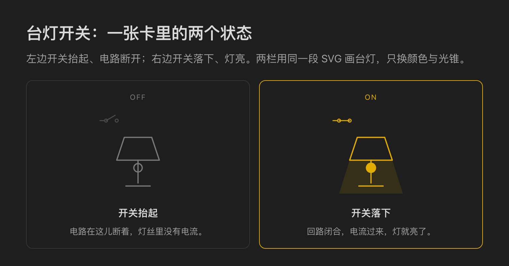

# h5-in-article-renderer

把 AI 写的 HTML 粘进 Obsidian 笔记，就变成一张和笔记同主题、同宽度、同字号的卡——写的时候是，阅读视图里也是。英文版见
[README.md](README.md)。



上面这张卡就是 [`examples/lamp-switch.md`](examples/lamp-switch.md) 里的第一个块。同一张卡在
[浅色主题](docs/screenshots/lamp-light.png) 下不用改一个字自动换色；[流程图](docs/screenshots/flow-dark.png)、
[指标卡](docs/screenshots/kpi-dark.png) 与 [看板](docs/screenshots/board-dark.png) 同样是一个 `h5-renderer` 里的静态 HTML。

**这个插件不做的事：**

1. **不执行脚本。** `<script>`、`on*` 事件属性和 `javascript:` 链接在显示之前就被剥离。
2. **绝不联网。** `<link>`、`@import`、远程字体、CDN 脚本、`<iframe>`/`<object>`/`<embed>`、非 `data:` 的 CSS `url()`，以及一切会触发请求的资源属性（`src`、`srcset`、`poster`、`xlink:href`）都会被剥离，所以渲染全过程零网络请求。普通超链接（`<a href="https://…">`）会保留——它只在你点击时才动作。
3. **不写回你的笔记。** Markdown 文件在处理前后逐字节一致，变的只有你看到的样子。展开卡片、让某个块保持源码、滚过一屏卡片——都不碰文件，也不动撤销栈。（*插入示例笔记* 命令只在你主动执行时新建一篇笔记，四项偏好存在插件自己的 `data.json` 里，两者都不碰你正在读的这篇笔记。）
4. **只认一个 fence：`h5-renderer`。** ```` ```html ```` 和其它所有 fence 与装插件之前完全相同——同样的代码、同样的属性、控制台不会有任何警告。唯一的刻意例外：第一次打开含普通 ```` ```html ```` 块的笔记时，笔记顶部会出现一次内联提示，告诉你该用哪个 fence。此后不再出现。

**正确写法：**

````markdown
```h5-renderer
<div class="card">
  <style>
    .card { display: grid; gap: 12px; color: var(--text-normal); }
  </style>
  <h3>标题</h3>
  <p>正文</p>
</div>
```
````

**错误写法**（会显示成普通代码块，这是刻意的）：

````markdown
```html
<div class="card"><h3>标题</h3></div>
```
````

**编辑时就是卡片，阅读视图里也是。** 写着的时候卡片就在：点它，它会展开成源码并落到你点的那个位置；
点到别处，卡片回来。阅读视图里，右上角切换按钮可以让某一块一直保持源码，直到你再点一次。这两种都只是
视图状态，文件永远不变。光标进到块里的那一刻，卡片会退回源码，所以打字永远不被打断。打印与导出的 PDF 里
同样是卡片。

## 安装

- **BRAT**：把本仓库加为 beta 插件，启用，然后在社区插件里打开 *H5 Card Renderer*。
- **手动**：新建 `<vault>/.obsidian/plugins/html-card-renderer/`，把 `main.js`、`manifest.json`、`styles.css` 放进去，重载 Obsidian 后启用。

需要 Obsidian `1.12.7` 或更新版本。在移动端实测通过之前，manifest 把本插件标记为仅桌面端；这里没有任何设计会让它必然不可用，该标记预期会改回去。

## 使用

1. 命令面板执行 **插入示例笔记**，得到一份三卡示例。
2. 命令面板执行 **复制给 AI 的要求**，把它粘给任何 AI。
3. 把 AI 返回的块粘进笔记——卡片当场就在你敲字的地方，不用切视图。
4. 点卡片即展开源码并落到点击位置，点到别处卡片回来。阅读视图里把鼠标移到卡片上会显现切换按钮，点它可让这一块一直保持源码，再点一次复原。任何选择都不会写到磁盘上。

[`examples/`](examples/) 里放着四篇可以直接抄的示例笔记：[台灯开关](examples/lamp-switch.md)、
[流程图](examples/flowchart.md)、[时间线](examples/timeline.md)、[指标卡与看板](examples/kpi-board.md)。
每篇都只有一个顶层容器类、只用主题变量，粘进任何主题都不会失配。

设置页恰好四项：启用渲染、新块默认状态（在 *渲染结果* 与 *源码* 之间选择）、显示切换按钮、
显示错误提示。改完立即作用于已经打开的笔记，不需要重载。

## 教程：一个块，从粘贴到卡片

**1. 先看一个成品。** 命令面板执行 **插入示例笔记**，会新建一篇带三张卡片的笔记——三列对比、
特性矩阵，以及一条用 div 排、内联 SVG 画箭头的流程。在编辑模式下点任意一张卡：它会展开成源码，并落到你点的那个位置；
点到别处，卡片回来。文件本身从头到尾没有变。

**2. 自己写一个。** 在任意笔记里打出 `h5-renderer` 这个 fence，里面写 HTML：

````markdown
```h5-renderer
<section class="status">
  <style>
    .status { display: grid; gap: 8px; color: var(--text-normal); }
    .status h3 { margin: 0; font-size: 1.05em; }
  </style>
  <h3>本周进展</h3>
  <p>三项已发，一项等评审。</p>
</section>
```
````

把光标移出这个块——在闭合 fence 后面按一次 `Enter`——卡片就出现在原位。

**3. 如果它还是代码块。** 按顺序检查：

- fence 名必须正好是 `h5-renderer`：小写、带连字符。`html` 永远不会渲染，这是刻意的；
- fence 要贴在行首，缩进小于四空格，且不在引用块或 callout 里；
- 前后两个 fence 都在——没闭合的块不算块。

**4. 改它。** 点卡片，光标会落到你点的那个位置并展开源码。直接打字。点到外面，卡片回来。
光标停在块里的期间卡片不会回来，所以打字永远不会被打断。

**5. 让 AI 写一个。** 命令面板执行 **复制给 AI 的要求**，粘给任意模型，再补上你的需求。
把回答粘进笔记，卡片当场出现。那段文字里的第 4 条决定同一篇笔记里两张卡会不会打架：
一个统一的顶层容器类，不写 `body` / `html` / `*` / `:root` 选择器。

**6. 阅读时把某块打开着。** 在阅读视图里，把鼠标移到卡片上，点右上角的切换按钮：这一块会一直
保持源码，直到你再点一次。这个选择只存在于当前视图，重新打开笔记会回到 *渲染结果*
（或者你的设置里定的 *源码*）。

## 性能与降级

渲染是同步的，每个块都按两级固定预算计时：超过 **50ms** 时本次仍正常显示，但下一次重渲染会降级为源码；
超过 **500ms** 时立即降级。降级块显示源码加一条提示，点 **预览** 会强制再渲染一次并绕过预算。
两个常量不可配置，且刻意没有 loading 态。

编辑态沿用同一对预算，另加一条让打字顺畅的门控：只有光标不在块内、块至少部分在屏幕上、且源码文本确实变了，
才会重建。滚出视野的块会释放渲染产物，滚回来时重建。

## 数据与隐私

没有 telemetry、没有统计、不访问网络。插件只存两类数据，且都在你的 vault 内：

- `.obsidian/plugins/html-card-renderer/data.json` —— 四项设置，加三个本地标记（引导是否已显示、示例是否已询问、示例是否被拒绝）。
- 别无其它。块状态（卡片/源码/保持源码）只在当前视图的内存里，编辑态与阅读视图各存一份——一边展开不会影响另一边。

删掉插件目录即清空以上全部。

## 给 AI 的约束卡

下面这段由 `scripts/sync-docs.mjs` 从 `src/constraint-card.md` 生成。不要在这里手改——
一旦副本漂移，`scripts/verify-docs.mjs` 会让发布失败。约束卡用中文写成是刻意的：它是给模型的指令，
一份规范措辞比两份更容易保持一致；它只有 8 条，读一遍就能核对。

<!-- constraint-card:start -->
````text
当你要为 Obsidian 笔记生成一段"可视展示块"时，请遵守以下约定：

1. 用代码块的 fence 名 h5-renderer，不要用 html：
   ```h5-renderer
   <div>...</div>
   ```

2. 只写静态内容：div / span / table / svg / style。
   不要写 <script>、不要写 on* 事件属性、不要写 javascript: 链接。

3. 不引用任何外部资源：不写 <link>、@import、远程字体、CDN 脚本、外部图片 URL。
   需要图形请用内联 <svg>。

4. 样式集中在一个 <style> 里，选择器收敛：
   不要把规则写到 body / html / * / :root 上；
   所有规则用一个统一的顶层容器类包裹（例如 .card），避免与其他块冲突。

5. 不写死尺寸：宽度用 100% 或 max-width，不要用 1200px 之类固定像素；
   高度同理，避免超出笔记栏或产生滚动条。

6. 颜色优先使用 Obsidian 的 CSS 变量，以便自动跟随浅色/深色主题：
   var(--text-normal)、var(--text-muted)、var(--background-primary)、
   var(--background-secondary)、var(--text-accent)、var(--background-modifier-border)。
   最外层容器不要设置不透明背景，保持透明以融入笔记。

7. 简单优先：优先用 flex / grid 做稳健布局，不追求炫技；
   单块代码尽量控制在 150 行以内。

8. 只输出这一个代码块，不要额外解释。
````
<!-- constraint-card:end -->

## 可访问性

切换按钮可用 `Tab` 到达、`Enter`/`Space` 触发，带随界面语言变化的 `aria-label`，焦点框用主题自带的
focus 色——编辑态用的是同一个控件，到达方式也一样。提示条为 `role="status"`，`aria-live="polite"`
（只在渲染失败时用 `assertive`），可聚焦因此 `Esc` 可关闭，且从不抢焦点。DOM 中不存在正值 `tabindex`、
没有 focus trap、不注册任何自定义快捷键；展开或收起卡片也不会移动焦点。

界面只提供中文与英文，其它界面语言回落到英文。卡片内容位于 shadow root 内，读屏器如何遍历它取决于
浏览器与主题。

**卡片内容自身的可访问性取决于 AI 写出的 HTML。** 插件不修复它，也不替它承诺。

## 排障

- **块显示成了普通代码块。** fence 必须严格是 `h5-renderer`，小写、带连字符。`html`、`h5`、`H5-Renderer` 都不识别。
- **在块里打字时卡片变回源码了。** 符合预期：光标在块内时就是源码，插件不会在光标下面重建。光标移出去，卡片就回来。
- **callout 或缩进列表里的块在编辑态仍是代码块。** 这些位置在编辑器无法可靠渲染时会退回普通代码块；同一块在阅读视图里照常显示为卡片。
- **卡片突然变成源码并带一条提示。** 它超出了渲染预算；点 **预览** 再渲染一次，或把卡片拆小。
- **卡片里的图片不见了。** 远程图片会被剥离以守住零网络；请用 `data:` 内联，或改用内联 `<svg>`。
- **提示说「已忽略脚本与外部引用」。** 该块含 `<script>`、`on*` 或远程引用；卡片其余部分照常显示。
- **我想让插件彻底消失。** 关闭 *启用渲染*：所有块回到普通代码块，页面不残留任何宿主、按钮或提示。

## Roadmap

- 编辑时（Live Preview）渲染：已在 `0.1.1` 交付，不再是 roadmap 项。
- 移动端专项适配：未排期；但当前设计不会让移动端必然不可用。

## 版本策略

遵循语义化版本，`manifest.json` 是唯一版本源；`versions.json` 记录每个版本对应的 `minAppVersion`。`npm run verify-docs` 会在 `manifest.version`、`package.json.version` 与 `versions.json` 条目不一致时失败（git tag 由发布流程自己校验）。

破坏性变更只限两类，且都在自动生成的 release notes 里给出迁移步骤：更换识别的 fence 名、增删或修改设置项。
同一大版本内，公开接口不会出现其它破坏性变更。

## 发布自己的构建之前

`manifest.json` 里有只有维护者才能提供的发布者身份。请先替换 `author`、`authorUrl` 与 `id`
（并在社区目录里确认 id 未被占用）。

## 许可

MIT，见 [LICENSE](LICENSE)。
